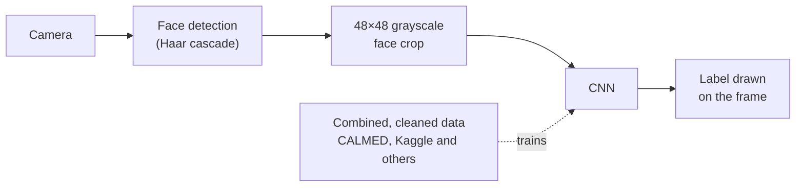

# CNN emotion detection

The CNN behind a real-time emotion-recognition prototype I built as a support tool for children with autism: training, a live camera test, and evaluation.




## What it is

Between 2022 and 2023 I developed a real-time emotion-recognition pipeline for children with autism, as a computer-vision intern at VIBE, a startup, in a small team with a mentor. The full prototype pairs facial landmarks with a convolutional neural network and runs in real time on a Jetson Orin Nano, a small computer that can sit right next to the camera.

A support tool that reads facial expressions has to work for the children it is meant for. That means learning from data that includes them, and keeping up in real time on a small device. Most of the work was in the data: I combined image and video data from CALMED (a dataset built for emotion detection in children with autism), Kaggle and other sources, and cleaned it into one training set. The sources label emotions in their own ways and record faces in different conditions, so they had to be made into something one model could learn from.

This repository is the CNN part of that work: the training script, a live test on a camera feed, and an evaluation with a confusion matrix and a classification report. The dataset isn't included.

## Highlights

| | |
| --- | --- |
| Development accuracy | about 92%, after combining and cleaning the data |
| Hardware | Jetson Orin Nano, in real time |
| Model input | 48×48 grayscale face crops |
| Outcome | the prototype and the concept were later acquired, following a Gulf-region competition |

## How it works

1. **Train.** `src/TrainModel.py` reads face images from `data/train` and `data/test` (one folder per class), rescales them to 48×48 grayscale, and trains a small Keras CNN: four convolution layers with max pooling and dropout, then a 1024-unit dense layer and a softmax output. It saves the architecture to `emotion_model.json` and the weights to `emotion_model.h5`.
2. **Run live.** `TestModel.py` opens a camera, finds faces with OpenCV's Haar cascade, crops and resizes each face to 48×48, runs the CNN on it, and draws the predicted label on the frame. The label map in the script groups the model's seven output classes into four colour labels: red, yellow, green and blue.
3. **Evaluate.** `src/EvaluateModel.py` runs the model over `data/test` and prints a confusion matrix and a classification report.

## Quick start

The pinned versions in `requirements.txt` date from TensorFlow 2.4, so use an environment with Python 3.8 or older.

```bash
pip install -r requirements.txt
```

Run everything from the repository root, since the scripts load `model/` and `haarcascades/` by relative path.

**Live test with the included model** (press `q` to quit):

```bash
python TestModel.py        # camera 0
python src/TestModel.py    # same test, camera 1
```

**Train your own model.** Put your images in `data/train/<class>/` and `data/test/<class>/`, set `train_data_qtt` and `test_data_qtt` in the script to your image counts, then:

```bash
python src/TrainModel.py
```

Training runs for 1000 epochs and takes hours on a laptop CPU. Copy the `emotion_model.json` and `emotion_model.h5` it writes into `model/`.

**Evaluate** on `data/test`:

```bash
python src/EvaluateModel.py
```

## Repository layout

```
.
├── TestModel.py          live camera test (camera 0)
├── src/
│   ├── TrainModel.py     trains the CNN
│   ├── TestModel.py      live camera test (camera 1)
│   └── EvaluateModel.py  confusion matrix and classification report
├── model/                trained architecture (.json) and weights (.h5)
├── haarcascades/         OpenCV frontal-face cascade
└── requirements.txt
```

## Limits

- The ~92% is development accuracy on the data I combined. It doesn't tell you how it will do with one particular child in one particular room.
- It reads facial expressions, and an expression is not always what someone feels. It is a support tool, never a diagnosis.
- The included model has seven output classes, while `src/TrainModel.py` currently builds a four-class output. A model retrained with it needs a label map that matches.
- The dataset isn't included, and the dependency pins are old.

## Links

- Project page: [ramikronbi.com/projects/emotion-recognition-autism-support](https://ramikronbi.com/projects/emotion-recognition-autism-support)
- Write-up: [Lessons from an edge emotion-recognition prototype](https://ramikronbi.com/writing/lessons-from-an-edge-emotion-recognition-prototype)
- CALMED dataset paper: [arXiv:2307.13706](https://arxiv.org/abs/2307.13706)

Built by Rami Kronbi during a computer-vision internship at VIBE, with a small team and a mentor. Licensed under Apache 2.0 (see [LICENSE](LICENSE)). [ramikronbi.com](https://ramikronbi.com)
